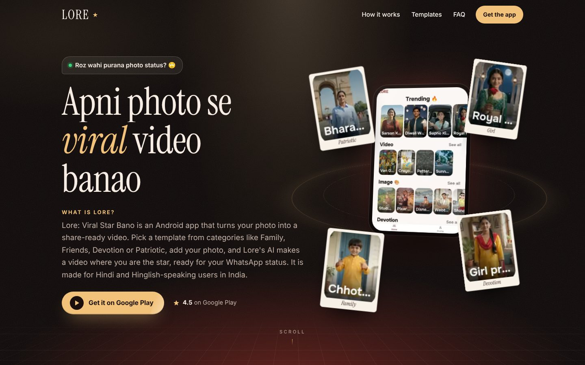
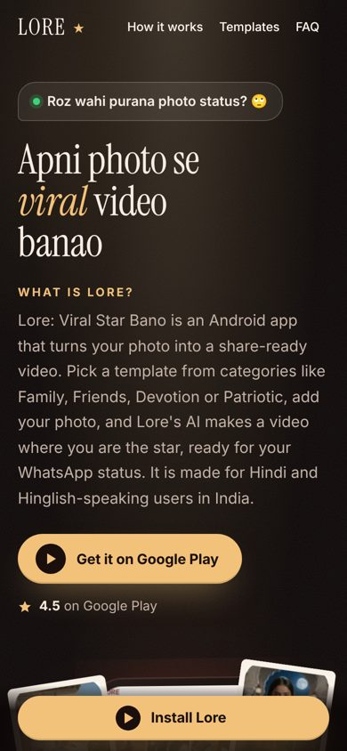

<div align="center">

# LORE ★

**Website for Lore: Viral Star Bano, an Android app that turns your photo into a share-ready video.**

[Live preview](https://lore-website-rho.vercel.app/) · [Google Play](https://play.google.com/store/apps/details?id=com.flippit) · [FAQ](https://lore-website-rho.vercel.app/faq)

&nbsp;&nbsp;

</div>

---

## About this project

This is a redesign of the Lore website, made for the **Lore SEO/AEO trial assignment**.
The goal: a fast site that Google and AI assistants (ChatGPT, Gemini, Perplexity) can read and understand easily.

- **Live preview:** https://lore-website-rho.vercel.app/
- **Current site (theflippit.com):** not changed. It was only audited.

## Results

PageSpeed Insights on the live preview (7 Nov 2026):

| Page | Performance | Accessibility | Best Practices | SEO | LCP |
|---|---|---|---|---|---|
| Home (mobile) | 100 | 100 | 100 | 100 | 1.0 s |
| Home (desktop) | 100 | 100 | 100 | 100 | 0.5 s |
| Templates (mobile) | 98 | 100 | 100 | 100 | 1.8 s |

The assignment target was mobile LCP under 2.5 s.

## What the assignment asked for, and where it is

| Requirement | Where |
|---|---|
| One H1 per page | `app/page.js` and each page |
| 40–60 word "What is Lore?" answer | Home hero (56 words) |
| App preview | Home hero (3D phone on desktop, CSS 3D on mobile) |
| Google Play button | Header, hero, mobile sticky bar, footer |
| 5+ FAQs with FAQPage schema | 7 on Home, 12 on `/faq` (`lib/faqs.js`) |
| MobileApplication + Organization schema | `lib/schema.js` |
| Unique title and meta description | Each page's `metadata` |
| Sitemap and robots.txt | `app/sitemap.js`, `app/robots.js` |

## Pages

| URL | What it shows |
|---|---|
| `/` | Home: hero, "What is Lore?", app preview, showcase, steps, FAQ |
| `/how-it-works` | Step-by-step guide |
| `/templates` | Template categories (3D wall on desktop, swipe cards on mobile) |
| `/faq` | 12 questions in English and Hinglish |

## SEO and AEO

- **Static HTML:** every page is pre-rendered at build time, so crawlers read the full text without running JavaScript.
- **Answer-first content:** short, direct answers near the top, written in natural English and Hinglish.
- **Structured data (JSON-LD):** Organization, WebSite, MobileApplication and FAQPage. The FAQ schema text matches the visible FAQ word for word.
- **Real facts only:** no made-up numbers, ratings or features. All facts come from the Play Store listing.
- **Open Graph image** for clean link previews on WhatsApp and social apps.

## Tech stack

- [Next.js 16](https://nextjs.org/) (App Router) and React 19
- Tailwind CSS v4
- GSAP for scroll animations
- React Three Fiber for the 3D phone (desktop only, loaded after first interaction)
- Hosted on Vercel

## Project structure

```
app/            Pages, layout, sitemap, robots, global styles
components/     Header, Footer, hero, FAQ list, 3D scene, Play button
lib/site.js     All facts and copy in one place (app name, Play link, rating)
lib/faqs.js     FAQ text (used by the page and the FAQPage schema)
lib/schema.js   JSON-LD builders
lib/og.js       Open Graph / share image settings
public/         Images, og.jpg
```

To change a fact (for example the Play link or rating), edit `lib/site.js` once and it updates everywhere.

## Run it locally

```bash
npm install
npm run dev
```

Open http://localhost:3000

Production build (every route should show `○ (Static)`):

```bash
npm run build
npm run start
```

---

<div align="center">

Made by **Lucky Verma** for the Lore SEO/AEO trial assignment.

</div>
